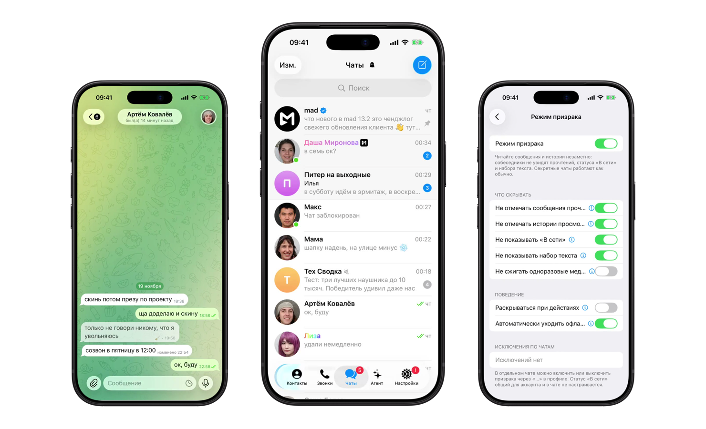
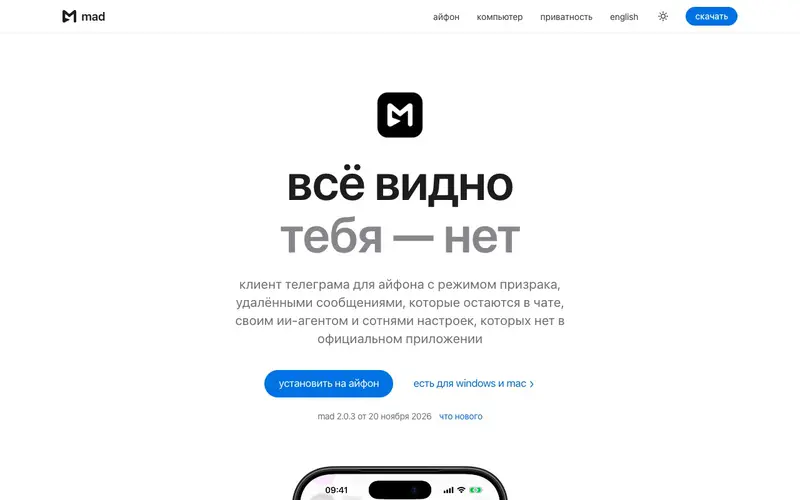

  

<h1 align="center">MadGram</h1>

  делаем mad, клиент телеграма для айфона, windows и mac

  <a href="https://mad.tg/"><b>mad.tg</b></a>
  ·
  <a href="https://github.com/madgram/mad-installer/releases/latest">скачать для айфона</a>
  ·
  <a href="https://github.com/madgram/mad-desktop/releases/latest">скачать для компьютера</a>
  ·
  <a href="https://t.me/maadgram">канал</a>
  ·
  <a href="https://t.me/+l-wwJloXQ802ZDcy">сборки для айфона</a>

  
  
  

  <picture>
    <source media="(prefers-color-scheme: dark)" srcset="assets/hero-dark.png">
    
  </picture>

---

## проекты

| | что это |
|---|---|
| [**mad-iOS**](https://github.com/madgram/mad-iOS) | клиент для айфона: режим призрака, удалённые сообщения остаются в чате, свой ии-агент и сотни настроек |
| [**mad-installer**](https://github.com/madgram/mad-installer) | ставит mad на айфон в пару кликов с мака или винды через бесплатный Apple ID и продлевает подпись |
| [**mad-desktop**](https://github.com/madgram/mad-desktop) | клиент для windows и mac на основе [tele](https://github.com/nitreojs/tele) и telegram desktop, ставится рядом с обычным телеграмом |

## на айфоне

- **режим призрака:** читаешь чаты и смотришь истории без отметок о прочтении и без «в сети»
- **удалённые и изменённые:** удалённые сообщения остаются в чате, у правок видна вся история
- **ии-агент:** пересказывает непрочитанное, ищет по всем чатам и пишет ответы, работает на твоём ключе
- **чаты под замком:** пин-код, пароль, графический ключ или face id на любой чат
- **профиль:** бейджи, ники с переливом и интеграции со стимом, гитхабом, спотифаем и не только
- **чистая лента:** без рекламы в каналах, спонсорских сообщений и меток слежки в ссылках

## на компьютере

- **режим стримера:** окно не попадает в запись экрана, в уведомлениях скрыты имена и текст
- **видно, когда был активен:** даже если человек скрыл «был в сети»
- **студия подарков:** собери любой коллекционный подарок и выгрузи в png, gif или стикер
- **скрипты и mtproto-консоль:** скрипты на js и ts с доступом ко всему api телеграма

## сайт

  <a href="https://mad.tg/">
    <picture>
      <source media="(prefers-color-scheme: dark)" srcset="assets/site-dark.webp">
      
    </picture>
  </a>
   
  <a href="https://mad.tg/">открыть mad.tg</a>

<b>english</b>

 

MadGram makes mad, a telegram client for iphone, windows and mac. ghost mode, deleted messages that stay in the chat, your own ai agent and hundreds of settings the official app doesn't have

- [**mad-iOS**](https://github.com/madgram/mad-iOS): the iphone client
- [**mad-installer**](https://github.com/madgram/mad-installer): installs mad on an iphone in a couple of clicks from a mac or windows pc with a free apple id
- [**mad-desktop**](https://github.com/madgram/mad-desktop): the windows and mac client built on [tele](https://github.com/nitreojs/tele) and telegram desktop

site: [mad.tg/en](https://mad.tg/en/) · channel: [t.me/maadgram](https://t.me/maadgram)

---

  mad неофициальный клиент, он не связан с телеграмом и не одобрен им. спасибо <a href="https://github.com/nitreojs">nitreojs</a> за tele и команде телеграма за открытый код

